# Azure from Novice to Expert

An Azure-only credential journey for technical consultants and solution architects who are new to Azure.

[Follow the interactive learning journey](https://stormydevil.github.io/azure-novice-to-expert/) or use the detailed track guides in this repository.

The path starts with infrastructure, then moves through data, AI, and applications and innovation. It combines Microsoft Certifications with Microsoft Applied Skills. It is intentionally not time-based: progress when you can explain the concepts, complete the hands-on work, and pass the relevant assessment.

> Credential catalog checked against Microsoft Learn on 12 October 2026. Microsoft changes exams and credentials regularly; review the [credential lifecycle guidance](docs/credential-lifecycle.md) before booking an exam.

## What this repository is about

This repository provides a structured Azure credential journey for partner technical consultants and solution architects who do not yet have Azure experience. It is a map rather than a calendar: it shows what to learn, which Microsoft credentials can validate that learning, and how the stages build on one another.

The intended outcome is broader than passing exams. A learner should gradually become able to:

- Explain Azure concepts to technical and non-technical stakeholders.
- Operate core Azure infrastructure before designing it.
- Make informed data, AI, application, and integration choices.
- Translate requirements into secure, reliable, supportable, and cost-aware Azure designs.
- Demonstrate broad role capability through Certifications and focused hands-on capability through Applied Skills.
- Build a Microsoft-verified credential record that can be shared with customers, employers, and professional networks.

## Design rationale

The path was built around five decisions:

1. **Start with Azure fundamentals.** Learners need a common vocabulary before specializing.
2. **Put infrastructure first.** Consultants and architects benefit from understanding identity, governance, networking, compute, storage, monitoring, and operations before designing data, AI, or application solutions on top of them.
3. **Follow with data and AI.** AI architecture depends on sound choices about data, security, networking, operations, and cost.
4. **Cover apps and innovation after the platform foundations.** This lets learners reason about hosting, integration, delivery, reliability, and DevOps in the context of the Azure platform.
5. **Combine breadth with proof of practice.** Role-based Certifications show broad capability, while Applied Skills add focused, scenario-based evidence.

Only active, Azure-focused credentials were included. Microsoft 365, Dynamics 365, Power Platform, Fabric, and non-Azure-specific security credentials were excluded to keep the route focused. Retired exams are mentioned only where a transition affects the current path.

## Certifications and Applied Skills

Microsoft Certifications and Microsoft Applied Skills are complementary credentials; Applied Skills do not replace Certifications.

| | Microsoft Certification | Microsoft Applied Skills |
|---|---|---|
| Scope | Broad: typically covers several skill areas needed for a job role | Focused: validates one specific skill set |
| Orientation | Role-based, such as administrator, developer, AI engineer, or solutions architect | Scenario-based and aligned to a specific business or technical challenge |
| Assessment | Certification exam covering the published study-guide domains | Performance-based assessment lab for the defined scenario |
| What it shows | Breadth of knowledge and skills needed to perform a role | Ability to complete a focused task or solve a defined problem |
| Place in this path | Primary milestones and progression from fundamentals to associate or expert | Hands-on validation alongside or between Certification milestones |

Use a **Certification** when you want to demonstrate that you can perform across a role. Use an **Applied Skills credential** when you want to prove a specific capability, strengthen an adjacent skill, prepare through hands-on experience, or show readiness for a particular project.

For example, Azure Administrator Associate demonstrates broad administration capability. The Applied Skills credential for deploying and configuring Azure Monitor provides narrower evidence that the learner can implement that particular operational scenario.

Microsoft notes that Applied Skills can support Certification preparation because they provide lab experience, but they do not cover every skill assessed by a Certification exam. See Microsoft's [Applied Skills FAQ](https://learn.microsoft.com/credentials/support/applied-skills-faq) and [Applied Skills process overview](https://learn.microsoft.com/credentials/support/appliedskills-process-overview).

## Learning order

| Stage | Track | Primary credential outcome |
|---|---|---|
| 0 | [Azure foundation](docs/00-foundation.md) | Microsoft Certified: Azure Fundamentals (AZ-900) |
| 1 | [Infrastructure](docs/01-infrastructure.md) | Azure Administrator Associate, then Azure Solutions Architect Expert |
| 2 | [Data](docs/02-data.md) | Azure Data Fundamentals, then Azure Database Administrator Associate |
| 3 | [AI](docs/03-ai.md) | Azure AI Fundamentals, Azure AI Engineer Associate, then Machine Learning Operations Engineer Associate |
| 4 | [Apps and innovation](docs/04-apps-and-innovation.md) | Azure Developer Associate, then DevOps Engineer Expert |

## Recommended route

Think of the route as an Azure journey: establish the cloud foundation, learn how the platform operates, and then add the data, AI, and application capabilities needed to design complete solutions.

```mermaid
flowchart LR
    START(("Start")) --> F["☁️ Stage 0<br/><b>Azure foundation</b><br/>AZ-900"]

    F --> I1["🛠️ Stage 1<br/><b>Operate Azure</b><br/>AZ-104"]
    I1 -. "optional network depth" .-> I2["🌐 <b>Azure networking</b><br/>AZ-700"]
    I1 --> I3["🏛️ <b>Design Azure solutions</b><br/>AZ-305"]
    I2 -.-> I3

    I3 --> D["🗄️ Stage 2<br/><b>Data</b><br/>DP-900 → DP-300"]
    D --> A["🤖 Stage 3<br/><b>AI</b><br/>AI-901 → AI-103 → AI-300"]
    A --> APP["🚀 Stage 4<br/><b>Apps and innovation</b><br/>AZ-204 → AZ-400"]
    APP --> OUT(("Azure<br/>architect"))

    classDef start fill:#ffffff,stroke:#0078d4,stroke-width:3px,color:#0078d4;
    classDef foundation fill:#e6f2ff,stroke:#0078d4,stroke-width:2px,color:#172b4d;
    classDef infrastructure fill:#e8f5e9,stroke:#107c10,stroke-width:2px,color:#172b4d;
    classDef data fill:#fff4ce,stroke:#ca5010,stroke-width:2px,color:#172b4d;
    classDef ai fill:#f3e8ff,stroke:#8661c5,stroke-width:2px,color:#172b4d;
    classDef apps fill:#ffe8f1,stroke:#e3008c,stroke-width:2px,color:#172b4d;
    classDef outcome fill:#0078d4,stroke:#005a9e,stroke-width:3px,color:#ffffff;

    class START start;
    class F foundation;
    class I1,I2,I3 infrastructure;
    class D data;
    class A ai;
    class APP apps;
    class OUT outcome;
```

| Journey stop | Learner focus | Credential signal |
|---|---|---|
| ☁️ Foundation | Learn the Azure language and core platform concepts | Foundational knowledge |
| 🛠️ Infrastructure | Operate, connect, govern, and design Azure environments | Administrator through expert architect capability |
| 🗄️ Data | Understand data workloads and administer Azure SQL | Data foundations and database operations |
| 🤖 AI | Build AI apps and agents, then operationalize AI systems | AI engineering and AI operations |
| 🚀 Apps and innovation | Build Azure applications and mature delivery practices | Developer through expert DevOps capability |

The route is guidance, not a claim that every exam has a formal prerequisite. Solid arrows show the recommended learning order; dotted arrows show optional depth. The track pages distinguish required prerequisites from recommended preparation.

## How to use this repository

1. Complete the tracks in the listed order.
2. Use the certification page as the source of truth for eligibility and exam availability.
3. Use the study guide to define the current assessment scope.
4. Add the suggested Applied Skills credentials where they support your role.
5. Build evidence as you learn: architecture diagrams, decision records, deployment templates, operational runbooks, and demos.

## What “expert” means here

Microsoft assigns levels to credentials, not to this repository. The two expert certification outcomes in this path are:

- Microsoft Certified: Azure Solutions Architect Expert.
- Microsoft Certified: DevOps Engineer Expert.

Data and AI currently culminate in role-based associate credentials and focused Applied Skills within this Azure-only scope. They are not relabeled as expert credentials.

## Microsoft Learn profile and credential record

Use one Microsoft Learn profile throughout the journey. After a credential is earned, Microsoft adds it to the profile's **Credentials** area, where Certifications and Applied Skills are shown separately. Verified credentials display an **Online Verifiable** indicator.

The Learn profile also provides a **Transcript** containing completed credentials and learning achievements. From the transcript, a learner can:

- Generate a shareable online link.
- Choose what information to expose through transcript sharing settings.
- Print the transcript or save it as a PDF.
- Provide a consolidated record to an employer, customer, or partner organization.

Open [your Microsoft Learn profile](https://learn.microsoft.com/users/me/), then use **Credentials** for individual achievements or **Transcript** for the combined record. Microsoft's [transcript guidance](https://learn.microsoft.com/credentials/certifications/view-share-transcript) explains the current steps.

### Sharing on LinkedIn and other social media

To share an individual credential:

1. Sign in to Microsoft Learn and open your profile.
2. Select **Credentials**.
3. Choose either **Certifications** or **Applied Skills**.
4. Open **View certification details** or **View credential details**.
5. Select **Share** and use the available LinkedIn or sharing option.

If adding it manually to LinkedIn, place it in **Licenses & Certifications** and use the Microsoft Learn verification link as the credential URL. The same verified link can be included in a social post, CV, portfolio, or email signature.

Before sharing, review the Learn profile privacy settings. A credential can be selected for sharing, but the profile must be in public view for another person to verify it online. Learners remain in control of whether their profile and credentials are public or private. See Microsoft's [credential sharing guidance](https://learn.microsoft.com/credentials/certifications/cred-share-validate).

Passing an exam is not itself a shareable credential. The resulting Certification can be shared after all of its requirements have been met. Passed exams still appear on the Learn transcript.

### Keeping Certifications current

Microsoft fundamentals Certifications do not expire. Eligible associate, specialty, and expert Certifications expire after one year and are renewed by passing a free online renewal assessment in Microsoft Learn before expiration. The renewal window opens six months before expiration.

The Learn profile shows eligible Certifications with a **Renew** option and updates the expiration date after a successful renewal. Review Microsoft's [Certification renewal FAQ](https://learn.microsoft.com/credentials/certifications/renew-your-microsoft-certification-faq) for current policy.

## Scope

Included:

- Active Azure-focused Microsoft Certifications.
- Active Azure-focused Microsoft Applied Skills.
- Official Microsoft Learn certification, study-guide, and assessment pages.

Excluded:

- Microsoft 365, Dynamics 365, Power Platform, Fabric, and security credentials that are not Azure-specific.
- Retired exams such as DP-100 and AI-102.
- Vendor training and unofficial exam material.
- Digital sovereignty-specific content.

## Repository maintenance

The link-check workflow checks Markdown links on changes and on a schedule. A successful link check proves that a page responds, not that Microsoft has kept the credential active. See [credential lifecycle](docs/credential-lifecycle.md) for the manual review process.

Contributions are welcome; read [CONTRIBUTING.md](CONTRIBUTING.md).
